# Hurricane Brawl

Six natural disasters brawl across a real 3D Earth, in the browser. You play a hurricane, tornado, blizzard, sandstorm, supercell or wildfire against one to five of the others. Feed on the terrain that suits you, wreck the cities in your path, knock out your rivals. Whoever has done the most damage to the world when the clock runs out wins.

It plays with a keyboard, a mouse or a controller (Xbox, Switch Pro or PlayStation), and needs no install and no build step.

<a href="media/trailer.mp4">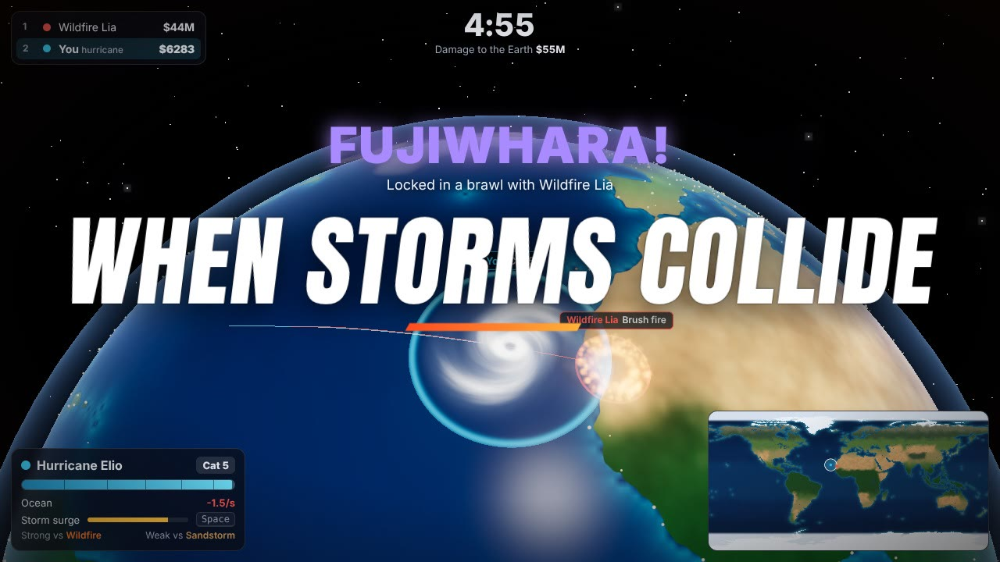</a>

**[Watch the trailer](media/trailer.mp4)** (1:00, recorded from the game) · **Play:** open `index.html` for the website or `play.html` for the game, or `HurricaneBrawl.html` (the whole game in one file) · **Deploy:** [Vercel](#the-website-and-vercel)

---

## Contents

1. [The game](#the-game)
2. [Controls](#controls)
3. [A match](#a-match)
4. [The storms](#the-storms)
5. [How it works](#how-it-works), with diagrams
6. [The Earth](#the-earth)
7. [The website and Vercel](#the-website-and-vercel)
8. [The trailer](#the-trailer)
9. [Checks](#checks)
10. [Project structure](#project-structure)
11. [Credits](#credits)

---

## The game

| | |
|---|---|
| 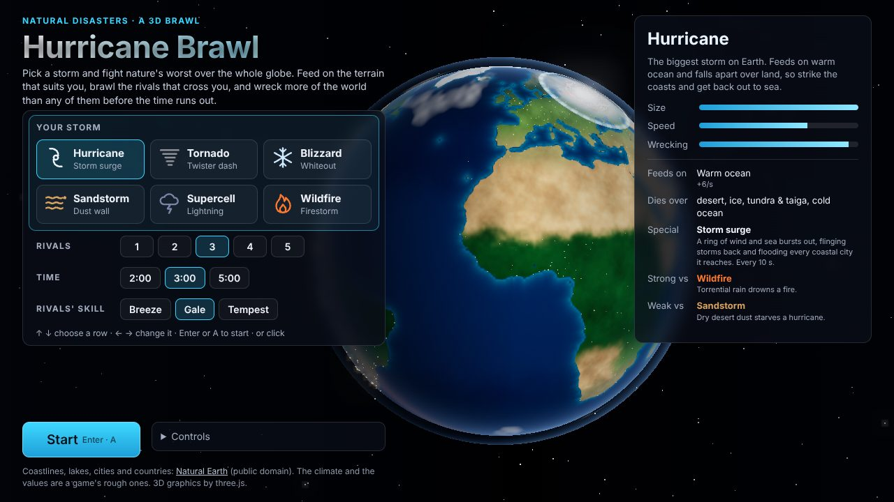 | 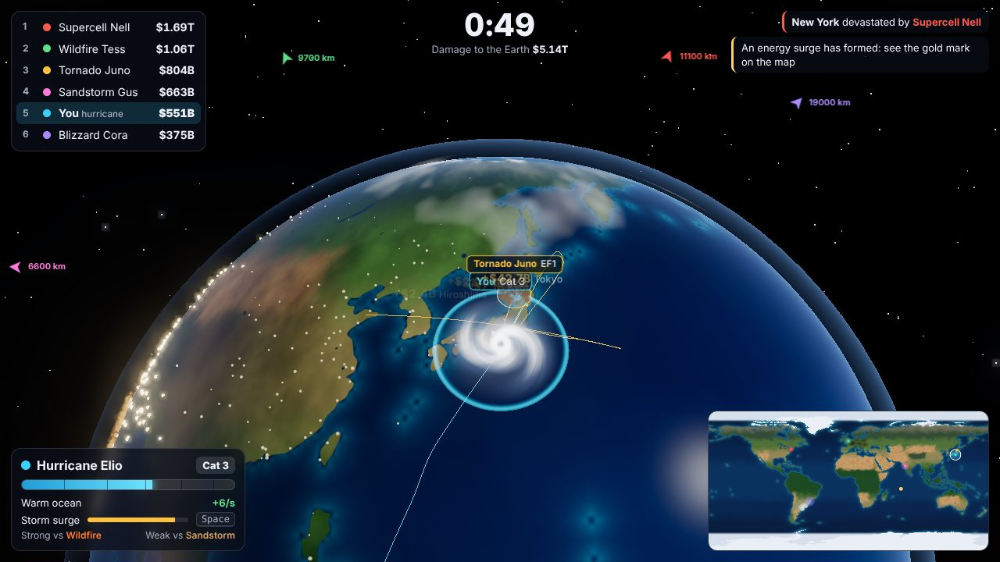 |
| **Pick a storm.** Choose the rivals (1–5), the time (2, 3 or 5 minutes) and their skill. A match between four AI storms plays behind the menu. | **Wreck the world.** Money pops up over every city you hit. The standings are at the top left, your storm's energy, terrain and special at the bottom left, the map at the bottom right. |
| 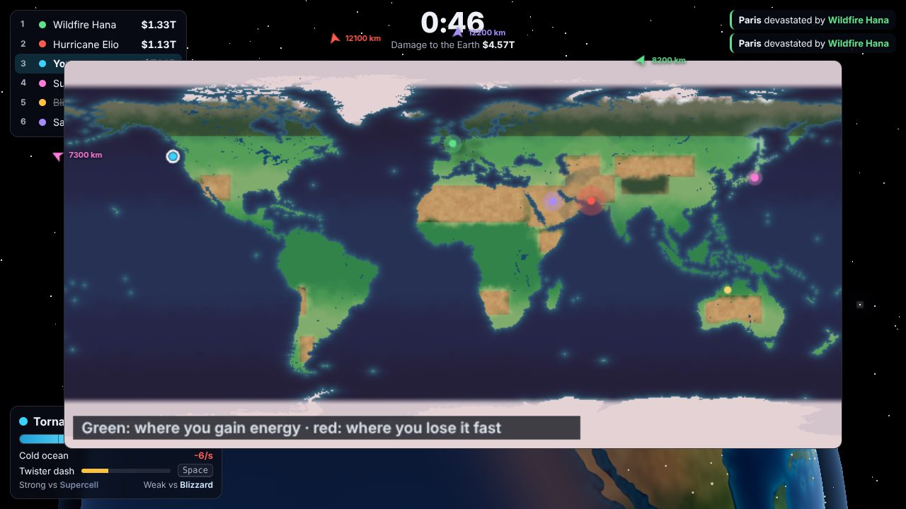 | 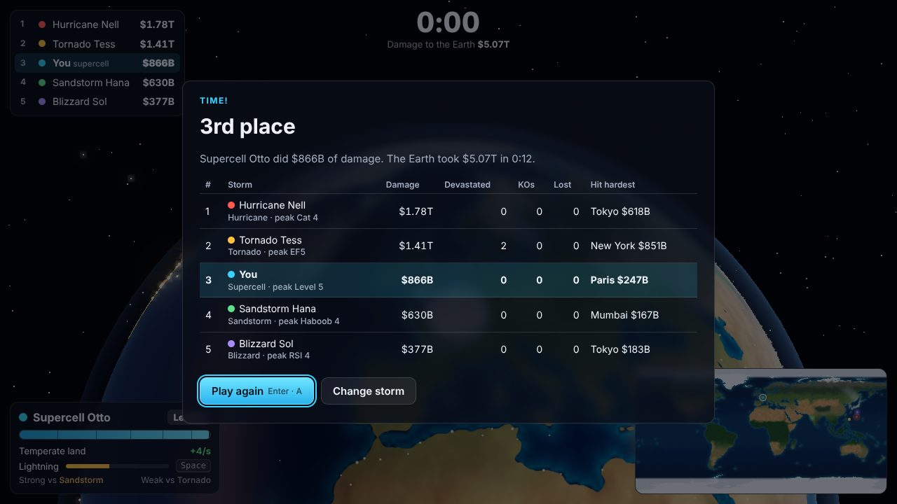 |
| **Read the map** (Tab, or View on a controller). Green is where your storm gains energy, red where it loses it fast. | **The results.** Ranked by damage, with what each storm devastated and the city it hit hardest. Your best for each storm is kept in this browser. |

The six storms, each with its special move:

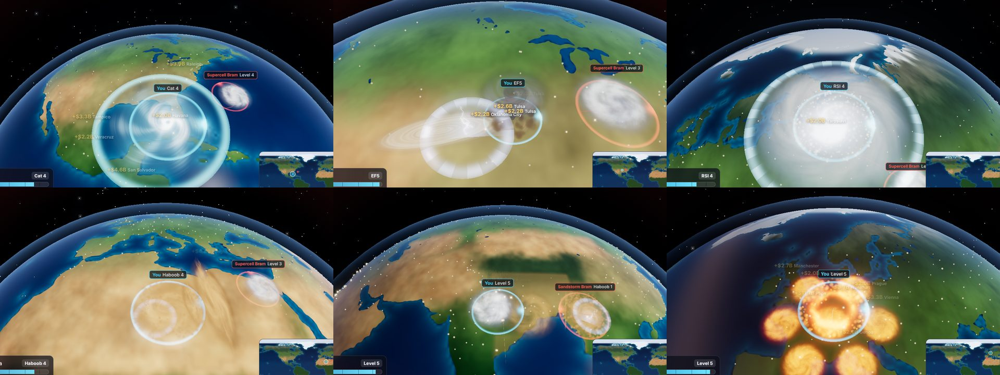

---

## Controls

| | Keyboard | Mouse | Controller (Xbox layout) |
|---|---|---|---|
| Move | W A S D, arrows | Hold the left button: toward the cursor | Left stick |
| Boost (x1.9 speed, costs energy) | Shift | Double-click and hold | A, right trigger |
| Special | Space | Right button (lightning aims at the cursor) | X, B, left trigger |
| Turn the camera · zoom | Q / E · Z / X | Middle-drag · wheel | Right stick |
| North up, or free | C | | Y |
| Big map | Tab | | View |
| Pause | Esc, P | | Menu |
| Sound on and off | M | | |
| Menus | arrows or WASD, Enter | click | d-pad or left stick, A; B back |

**Other controllers.** Any controller the browser gives the Gamepad API's standard mapping works the same way, by button position. The on-screen hints use its own button names:
- **Nintendo Switch Pro Controller:** B or ZR boosts, Y or ZL fires the special, X turns north up, − opens the big map and + pauses. In menus A picks and B goes back, as on the Switch.
- **PlayStation:** ✕ or R2, □ or L2, △, Create and Options.
- **Joy-Cons:** a pair works where the browser presents them as one standard controller; a single Joy-Con doesn't have the standard mapping.

Rumble works where the browser and the controller support it. On a touch screen, holding a finger on the globe steers; there are no on-screen buttons for boost or the special.

---

## A match

- **Start.** Every storm starts with 60 energy (of 100) at a place that feeds it, near plenty of cities and away from the others. The rivals are the other types, picked at random.
- **Energy is everything.** It is your health and your size (the radius grows with its square root). The terrain under your centre adds or takes it every second; boosting costs 6 a second. The HUD shows your category on your storm's own scale: hurricane Cat 1–5, tornado EF0–EF5, blizzard RSI 1–5.
- **Damage.** Every city and every 1° cell of countryside within your radius loses a share of what is left of it each second. You are credited with what it lost, in US dollars, so a city hit again pays less. A city below 30% of its value is "devastated".
- **Rebuilding.** Everything damaged gets back 0.8% of what it lost each second (half in about 90 s), so the cities wrecked early are worth hitting again later.
- **Brawls.** Two storms closer than 0.7 times the sum of their radii lock together and orbit their midpoint: counter-clockwise in the north, clockwise in the south (the Fujiwhara effect). Each drains the other's energy, harder for the stronger, the bigger and the one that wins the matchup. The one draining faster takes in 40% of what the other loses.
- **Rams.** Boosting or dashing in faster than 250 km/s hits for 10 x energy/100 and knocks the other back at 700 km/s.
- **KOs.** A storm at zero energy is gone. If a rival hit it in the last 4 s, that rival is credited with the KO and takes in 25 energy. It comes back 4 s later, at a place that suits it, with 50 energy and 2.5 s of shield.
- **Moving on the globe.** The prevailing winds carry the storms: the trade winds westward in the tropics, the westerlies eastward further out (−60 cos 3φ km/s toward the east at latitude φ). How much depends on the type: a wildfire 0.3, a hurricane 1.
- **Energy surges.** An orb appears every 18 s (two at most): the first storm to reach it gets 35 energy and 5 s at x1.3 speed.
- **The end.** When the time runs out, the storms are ranked by damage.

---

## The storms

| Storm | Feeds on (energy/s) | Dies over (energy/s) | Radius (km) | Speed (km/s) | Hits harder | Special |
|---|---|---|---|---|---|---|
| Hurricane | warm ocean +6 | desert and ice −7, tundra −6, temperate land and cold ocean −5, tropical land −4 | 280–760 | 380 | coastal cities x1.7 (inland x0.55) | Storm surge, 10 s |
| Tornado | temperate land +6, tropical land +3 | cold ocean −6, ocean −5, ice −5, warm ocean −4 | 110–240 | 560 | temperate land x1.2 | Twister dash, 6 s |
| Blizzard | ice +6, tundra +5, cold ocean +4 (temperate land +2.5) | warm ocean, tropical land −6; desert −4 | 300–700 | 350 | tundra x1.3, temperate land x1.2 | Whiteout, 12 s |
| Sandstorm | desert +7 | the seas −5 to −6, ice −5, lakes −4 | 230–580 | 440 | desert x1.4 | Dust wall, 8 s |
| Supercell | tropical and temperate land +4, warm ocean +3 | ice −5 (nowhere else worse than −3) | 170–430 | 470 | | Lightning, 6 s |
| Wildfire | temperate land +5, tropical land and tundra +3 | every sea −7, ice −7, lakes −5 | 170–470 | 360 | deserts x0.6, coasts x0.8 | Firestorm, 11 s |

**The specials.**
- **Storm surge:** a ring from 0.6 to 2.4 radii in a second. A rival it reaches loses 20 x energy/100 (x the matchup) and is flung back. Every city it passes is flooded, coastal ones most.
- **Twister dash:** 0.9 s at 3.2 times the speed, wrecking 2.5 times as hard. A rival it rams takes 2.2 times a ram's hit; the tornado takes half the brawl drain while dashing.
- **Whiteout:** for 5 s everything within 2.4 radii crawls at x0.45 speed and loses 5 energy a second.
- **Dust wall:** a wall 3.6 radii wide rolls out ahead at 1,500 km/s for 1.4 s. A rival in its way loses 16 x energy/100, is pushed on and slowed; each city it passes is hit once.
- **Lightning:** three bolts where you aim (the mouse) up to 2,600 km away, or at the nearest rival in range. Each takes 9 x energy/100 from a rival within about 320 km and wrecks the cities within 240 km.
- **Firestorm:** seven patches of fire round the wildfire burn for 7 s. A rival in them loses 6 energy a second, and the cities in them burn.

**The food chain.** Each storm does 1.5 times the drain to the one it beats, and 0.7 times to the one that beats it:

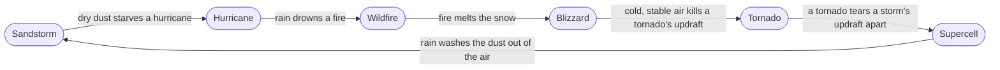

**The rivals** give the same inputs a player would. Their skill sets how often they think (every 0.9, 0.5 or 0.3 s), how often they use a special when it pays (45%, 80% or 100%), how well lightning aims and how readily they pick a fight:

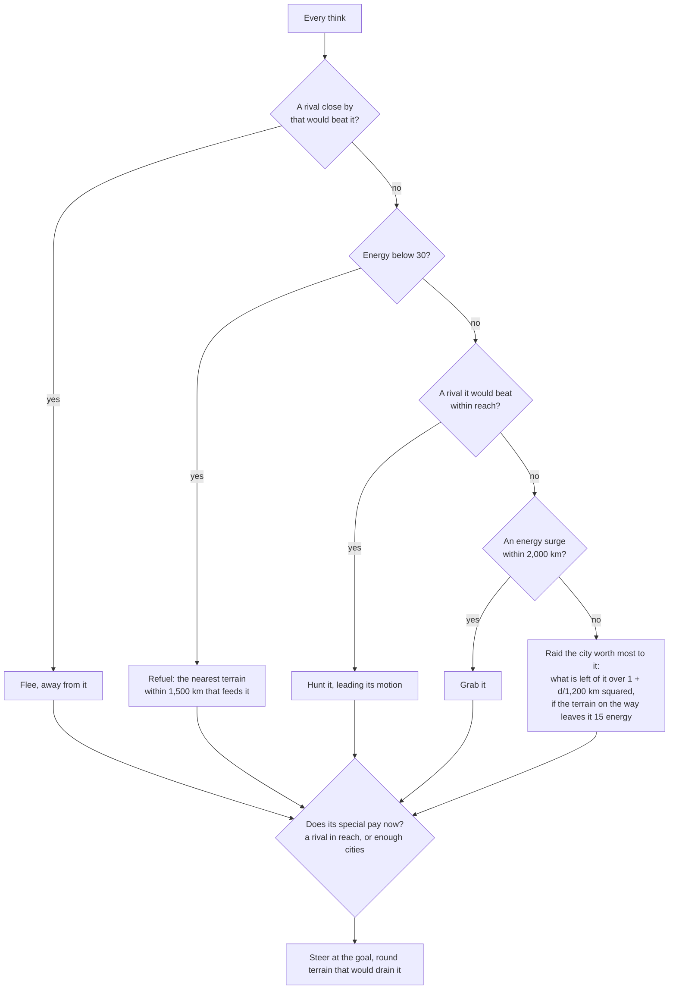

---

## How it works

The game is plain JavaScript classic scripts: no framework and no bundler. three.js comes from the jsDelivr CDN. The simulation (`earth.js`, `storms.js`, `sim.js`, `ai.js`) touches no DOM, so it runs in Node for the checks as it does in the page.

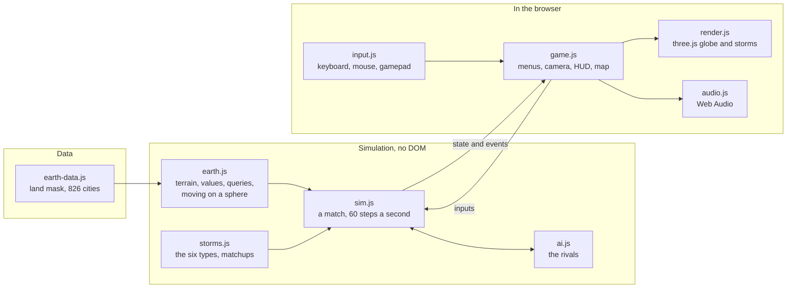

**One frame.** The match steps at a fixed 1/60 s, as many steps as the frame's time allows (up to six). Each step's events (cities hit, specials, bolts, hits, KOs, energy surges) drive the HUD, the sounds and the effects:

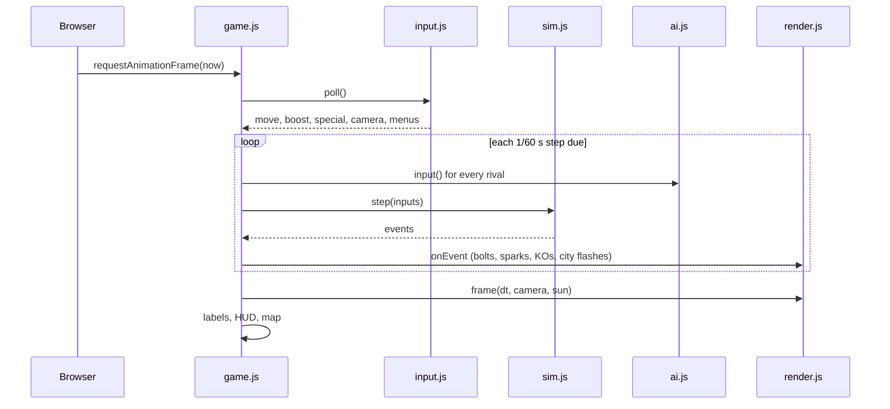

**One step** of `sim.js`, in order:

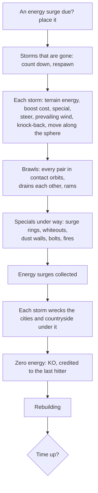

**The screens.**

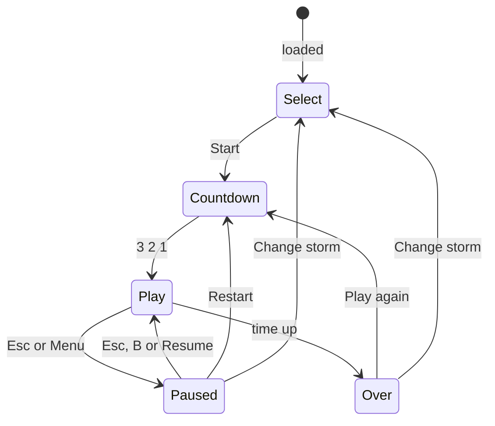

**Moving on a sphere.** A storm's position is a unit vector and its velocity a tangent vector, moved along great circles; after each step the velocities are carried into the new tangent plane. So the poles and the date line are nothing special.

**The camera** rides above your storm, tilted toward the top of the screen: 35° at its lowest and 13° at its highest, between 2,500 and 16,000 km up. North stays up unless you turn it. Your keys or stick are turned into a direction on the globe from it, and the mouse picks the point on the globe under the cursor.

**Rendering** (`render.js`).
- **The globe.** One sphere, with a 2048 x 1024 texture built at load from the land mask and the climate. The land's colours blend along borders warped by noise, the sea's come from the depth near the coast, and the alpha holds the mask blurred over five cells so the shader draws a smooth coast at any zoom. A sun goes round once every two minutes: city lights at night, the sun's glint on the sea, a rim of atmosphere, thin clouds. A damage layer is tinted by the storm type that did it.
- **The storms.** Discs bent onto the sphere in the vertex shader, with one cloud shader for all of them: spiral arms, an eye, noise that turns faster near the middle. Each type adds its own parts: the tornado's funnel, wall cloud and dust trail; the supercell's anvil and flashes; the wildfire's fire front and smoke; the sandstorm's dust front. Particles (debris, snow, dust, embers) move on the GPU.
- **Few programs.** Discs, rings, walls, funnels and particles each have one shader, shared by every storm.

---

## The Earth

`js/earth.js`, with `js/earth-data.js` built by `tools/fetch-earth.js` from [Natural Earth](https://www.naturalearthdata.com) (public domain).
- **Land and lakes.** The 1:50m land with its lakes cut out, at 2048 x 1024 cells (about 20 km). An island too small to hold a cell's centre (Malta, Madeira) still gets one cell.
- **Climate.** Every half-degree cell is sea, lake or land, with a terrain from its latitude and a few boxes:
  - **Warm ocean** within 26° of the equator, except the cold currents off the oceans' eastern sides, plus the Gulf of Mexico, the Gulf Stream and the Kuroshio. Beyond 45° (40° in the south) it is cold ocean; past 78° N or 68° S, sea ice.
  - **Deserts:** the Sahara, Arabia, Iran to the Thar, Central Asia, the Taklamakan and Gobi, the US Southwest, the Namib and Kalahari, the Atacama, Patagonia, the Horn of Africa and inland Australia.
  - **Land:** tropical within 18° of the equator, tundra and taiga beyond 55° (and Tibet), ice in Antarctica, Greenland and past 72° N, temperate elsewhere.
- **Cities.** The 826 populated places with a metro population of 200,000 or more. Each is worth its population x ($15,000 + 0.6 x its country's GDP per person). A rich city is worth more, but not in proportion. Together they are worth $38.3 trillion.
- **The countryside.** Worth 30% of that ($11.5 trillion), spread over the 1° land cells by area and by the value of the cities within 1,200 km. Deserts, tundra and ice are worth less.
- **These are a game's numbers.** The climate is a rough sketch, and the values are a rough measure of what is built in a place, not economic data.

```
NODE_USE_ENV_PROXY=1 node tools/fetch-earth.js    downloads the four layers (about 6 MB; the variable only behind a proxy)
node tools/fetch-earth.js <dir>                    from the .geojson files already in <dir>
```

---

## The website and Vercel

| | |
|---|---|
| 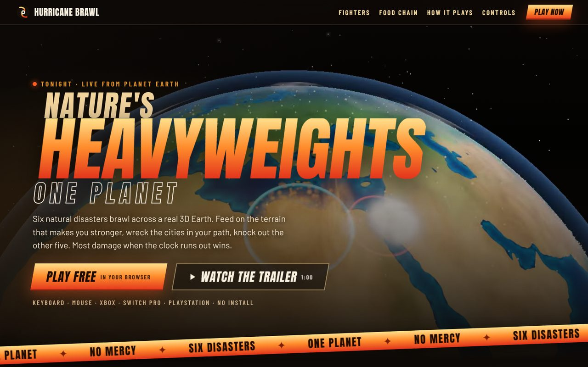 | 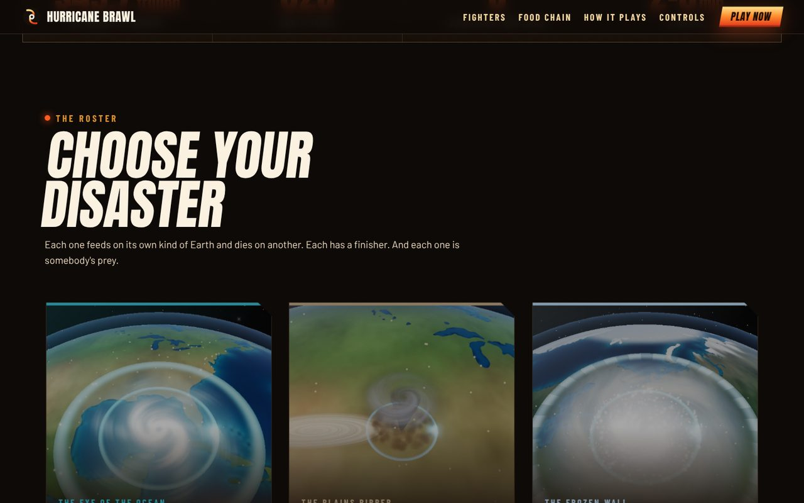 |

`index.html` is the landing page: the game's footage behind the title, the trailer, the six fighters, the food chain, how it plays, and the controls. **Play** goes to `play.html`, the game. Its fighter cards and food chain are generated from `js/storms.js` by `tools/build.js`, so they show the game's own numbers. The fonts (Anton and Barlow, SIL Open Font License) are served from `fonts/`.

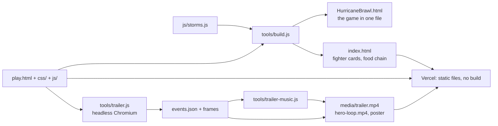

**Deploying on Vercel.**
1. In Vercel, **Add New → Project**, and import `jayrosen-design/hurricane-brawl` from GitHub.
2. Keep the framework preset **Other**, with no build command and the root as the output.
3. Deploy. Every push to `main` deploys again.

The site is static, and `vercel.json` only turns on clean URLs (`/play` serves `play.html`). `.vercelignore` leaves the tools, the README and its pictures off the site. Any other static host (GitHub Pages, Netlify) works too, and so does opening `index.html` from disk.

**After changing the storms** (`js/storms.js`) or the game, rebuild:

```
node tools/build.js      HurricaneBrawl.html, and index.html's fighter cards and food chain
```

---

## The trailer

`media/trailer.mp4` (60 s, 1280 x 720, 30 fps, H.264 with AAC) is recorded from the game by `tools/trailer.js`. It also writes `media/trailer.webm` (VP9 and Opus, for browsers without H.264, such as Chromium builds), `media/trailer-poster.jpg`, and the landing page's background: `media/hero-loop.mp4` and `.webm` (16 s of the brawl and the specials, without titles, HUD or sound, from a second, clean copy of those frames taken while the takes record) with `media/hero-poster.jpg`.
- **A virtual clock.** The page's `requestAnimationFrame`, `performance.now`, `setTimeout` and CSS animations all advance exactly 1/30 s per captured frame. So the video is smooth however long a frame takes to draw, even in software WebGL at about a third of a second a frame.
- **Ten takes** (`tools/trailer-shots.js`). The opening over the turning globe; each storm using its special, staged where it belongs (a hurricane in the Gulf, a tornado on the plains, a blizzard over Russia, a sandstorm over the Sahara, a supercell over India, a wildfire over France); a hurricane hunting a wildfire over the open sea to a knockout; a six-storm melee; the end card. Each take is a fresh run of the game. Your storm is played with key presses, and in the brawl and the melee by the game's own AI.
- **The soundtrack** (`tools/trailer-music.js`) is synthesised: no samples, 120 BPM in D minor, cut on the beat. It adds a sound where each of the game's events happened (specials, bolts, hits, the KO), from the recording's `events.json`.

```
npm i playwright && npx playwright install chromium
node tools/trailer.js [--three <dir>] [--chrome <path>] [--ffmpeg <path>] [--takes a,b] [--encode-only]
```

It needs ffmpeg with libx264, libvpx-vp9 and libopus. `--three` serves three.js from a local copy of its npm package when the CDN can't be reached. The whole recording takes about 20 minutes.

---

## Checks

```
node tools/check.js           the simulation in Node (about 20 s)
node tools/check.js brawl     only the checks whose names contain "brawl"
```

It exits non-zero if any of these fails:
- **The Earth.**
  - The mask decodes to its size and is about a third land.
  - 15 known places have the right terrain (London, the mid-Pacific, the Sahara, Antarctica, Kansas, the Amazon, Siberia, the North Atlantic, the Gulf of Mexico, Lake Victoria, Greenland, off California, the Philippine Sea, the outback, Perth).
  - Every city has land within 60 km, and the countryside is worth 30% of the cities.
- **Queries:** `citiesNear` and `ruralNear` find what a search of everything finds, at 45 points (by the poles and across 180° too) and three radii.
- **Motion:** a storm steered east stays on the sphere and moves at its speed plus the wind; boost is x1.9 and costs energy.
- **Terrain:** a hurricane gains over warm ocean and loses over Kansas; a tornado the other way round.
- **Damage:** a tornado on Tokyo wrecks it, the damage credited is what Tokyo lost, and the storms' totals add up to the Earth's.
- **Brawls.**
  - Equal storms drain each other equally, and a sandstorm beats a hurricane.
  - Locked storms turn counter-clockwise in the north and clockwise in the south.
  - A KO is credited, and the storm comes back 4 s later.
- **Specials:** each type's move does what it says to a rival placed for it, and nothing beyond its reach.
- **Matches:** three-minute matches of all six AI storms at each skill have no NaN, end on time, and every storm scores; the same seed gives the same match.
- **Balance:** over six matches, each type's average damage is within x0.5–x2 of the mean. In the last run the wildfire was x1.34 and the blizzard x0.77, the others between.

**In the browser.** `play.html?test=1` (with `&time=<seconds>`) lets an AI play your storm at once, and puts the results in `window.__brawl`. Other settings: `?storm=`, `?rivals=1-5`, `?vs=wildfire,tornado` (the rivals' types), `?time=`, `?ai=breeze|gale|tempest`, `?seed=`, `?demo=0`, `?bloom=0`, `?clouds=0`.

**Checked in headless Chromium (software WebGL)** with scripts that aren't in the repository:
- **The game** (`play.html` and `HurricaneBrawl.html`): the keyboard, the mouse and a simulated Switch Pro Controller and Xbox controller each pick a storm, start, move, boost, fire the special, pause and play again, with no errors. `HurricaneBrawl.html` copied alone into an empty folder plays a match.
- **The landing page**, served over HTTP:
  - it loads with no errors, and its fonts, pictures and background video load;
  - the six cards and the food chain are there;
  - the trailer opens in its dialog and plays with sound, and Esc or a click on the backdrop closes it and stops it;
  - Play opens the game;
  - on a 390 px phone nothing scrolls sideways;
  - with reduced motion, the background video and the moving tape hold still.
- **The README's diagrams** parse and render with Mermaid 11.

**Not verified:**
- **Hardware:** a real Switch, Xbox or PlayStation controller; a phone.
- **Frame rate on a real graphics card.**
- **The sound:** the game's sound and the trailer's soundtrack weren't listened to.

---

## Project structure

```
index.html            the landing page (its fighter cards and food chain are generated by tools/build.js)
play.html             the game: its page and script loader
HurricaneBrawl.html   generated: the game in one file (tools/build.js)
favicon.svg
css/
  brawl.css           the game's menus, HUD, map, labels and banners
  site.css            the landing page
  fonts.css           Anton and Barlow, from fonts/
js/
  earth-data.js       generated: the land mask, the cities and their countries' GDP per person
  earth.js            the Earth: terrain, the cities' and the countryside's values, queries, moving on a sphere
  storms.js           the six storms, their specials, who beats whom
  sim.js              a match: motion and winds, energy, damage, brawls, rams, specials, KOs, surges, rebuilding
  ai.js               the rival storms
  input.js            keyboard, mouse and gamepad (Xbox, Switch and PlayStation names), rumble
  audio.js            the game's sound, synthesised with Web Audio
  render.js           the globe, the storms, their moves, the damage layer, the camera
  game.js             select, a match, the HUD and the map, labels, pause, results
  site.js             the landing page's trailer dialog
fonts/                Anton and Barlow (woff2) and their licences
media/                the trailer, its poster, the hero loop and the landing page's pictures
media/readme/         this README's pictures (not deployed)
tools/
  build.js            HurricaneBrawl.html and the landing page's generated parts
  check.js            the simulation's checks, in Node
  fetch-earth.js      builds js/earth-data.js from Natural Earth
  trailer.js          records the trailer in headless Chromium and encodes it
  trailer-shots.js    the trailer's takes
  trailer-music.js    the trailer's soundtrack
vercel.json           clean URLs
.vercelignore         what stays off the website
```

---

## Credits

- **Map data:** coastlines, lakes, populated places and country figures from [Natural Earth](https://www.naturalearthdata.com), public domain, through its GitHub mirror [nvkelso/natural-earth-vector](https://github.com/nvkelso/natural-earth-vector).
- **[three.js](https://threejs.org/)** (MIT), loaded from jsDelivr, with its post-processing passes for the bloom.
- **Fonts:** [Anton](https://github.com/googlefonts/AntonFont) and [Barlow](https://github.com/jpt/barlow), SIL Open Font License 1.1 (`fonts/LICENSE-*.txt`).
- **The trailer's music** is synthesised by `tools/trailer-music.js`; the game's sounds by `js/audio.js`. Neither uses samples.

A game about weather, not a forecast: the storms, the climate and the values are simplified for play.
